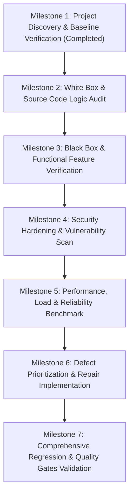

# PROJECT_TEST_PLAN.md
# Comprehensive Quality Assurance, Test Strategy & Execution Plan
**Project:** QuizVerse — Intelligent Academic Assessment & AI Studio  
**Audit Team:** Principal Software Architect, Senior QA Engineer, White/Black Box Testing Specialists, Security Testing Engineer, Reliability & Performance Engineers  
**Date:** November 01, 2026  

---

## 1. Executive Test Strategy Overview

The objective of this comprehensive test plan is to thoroughly validate QuizVerse from the inside out, applying rigorous verification across every architectural tier:
```
[Client UI / Browser] <---> [Flask Routing & Middleware] <---> [Microservices & AI Engines] <---> [SQLite Database]
```

### Core Principles
1. **Zero Assumption Rule:** Never assume a feature works simply because code exists.
2. **Actual Execution Mandatory:** Every test case must be executed against live application instances with recorded metrics.
3. **No Fabricated Evidence:** Metrics, timings, and error rates must be directly measured and documented.
4. **Non-Destructive Operations:** Tests must preserve benchmark seed data and use transaction rollbacks or isolated fixtures.

---

## 2. Test Scopes & Categories

| Category | Objectives | Frameworks / Tools |
|---|---|---|
| **White Box Testing** | Statement coverage, branch coverage, loop boundaries, exception flows, and cyclomatic complexity | `pytest`, `unittest`, Python `trace`, AST analysis |
| **Black Box Testing** | Equivalence partitioning, boundary values, state transitions, error guessing, and user journeys | `pytest`, Web client, DOM test harnesses |
| **Integration Testing** | Inter-module data flow: Ingestion -> Question Bank -> Quiz Runner -> Submission -> Scoring -> Analytics | Flask Test Client, SQLite transaction harnesses |
| **API Testing** | Validate all REST endpoints for request schema, status codes, payload formatting, and edge cases | Python `requests`, Flask Client, JSON validator |
| **Database Testing** | Schema integrity, foreign keys, composite indexes, WAL concurrency, and SQL injection resistance | SQLite3 PRAGMA checks, ACID concurrency testers |
| **Security Testing** | OWASP Top 10: CSRF, XSS, CSV formula injection, Open Redirects, RBAC bypass, and Session Fixation | Custom security fuzzers & payload injectors |
| **Performance Testing**| Response latencies (mean, P95, P99), queries per second, memory leak profiling, and throughput | `cProfile`, `tracemalloc`, high-resolution timer |
| **Load & Capacity** | Multi-threaded concurrent request simulations (1, 5, 10, 25, 50 users) under controlled workloads | Python `concurrent.futures`, ThreadPool load tester |
| **Reliability Testing**| High-frequency repeated transactions, recovery after simulated network/API failures | Chaos injectors, repeated cycle runners |

---

## 3. Test Environments & Configuration

- **OS:** Windows 11 (64-bit)
- **Runtime:** Python 3.12.10
- **Database:** SQLite 3 (WAL mode enabled, foreign keys enabled)
- **Dependencies:** Flask 3.0.3, Werkzeug 3.0.3, requests 2.34.2, python-dotenv 1.0.1, pypdf 6.14.2, pytest 8.2.2, pytest-flask 1.3.0
- **Test Database Isolation:** In-memory or temporary SQLite test databases created per test fixture to prevent production data corruption.

---

## 4. Test Schedule & Phased Milestones



---

## 5. Pass / Fail Quality Criteria

- **Critical & High Defects:** 0 unresolved defects permitted for release readiness.
- **Automated Test Pass Rate:** 100% of unit, integration, security, and regression tests must pass.
- **API Error Rate:** < 0.1% under normal operational concurrency.
- **Latency SLAs:** P95 response latency < 350ms for local database-backed endpoints.
- **Data Integrity:** 0 data loss, 0 referential integrity violations, 0 corrupted attempt rows.

